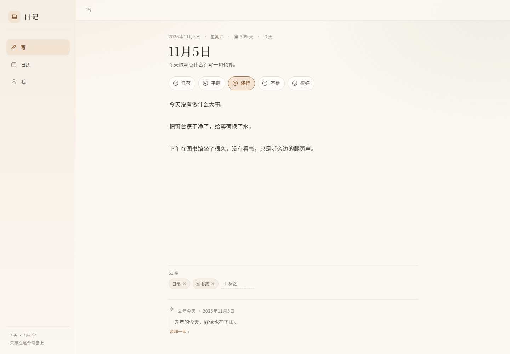
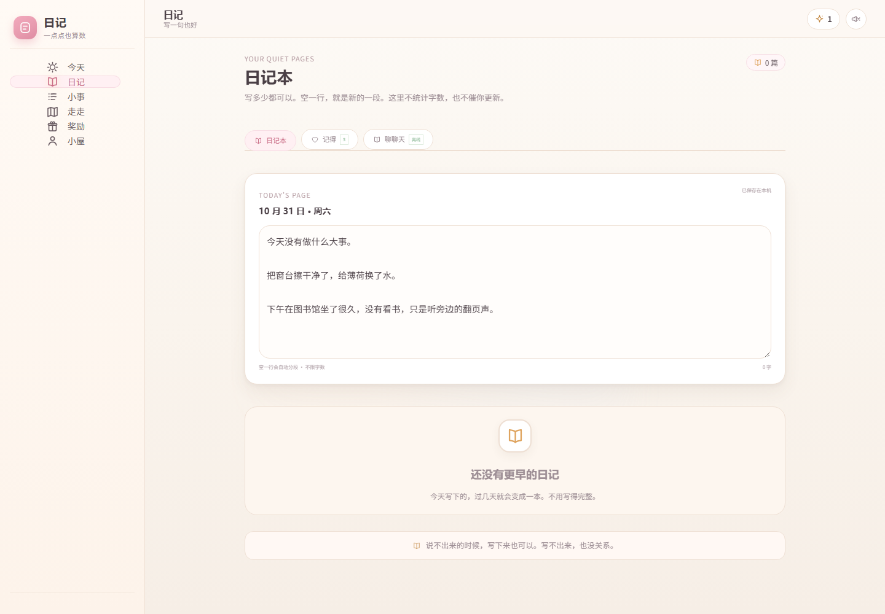
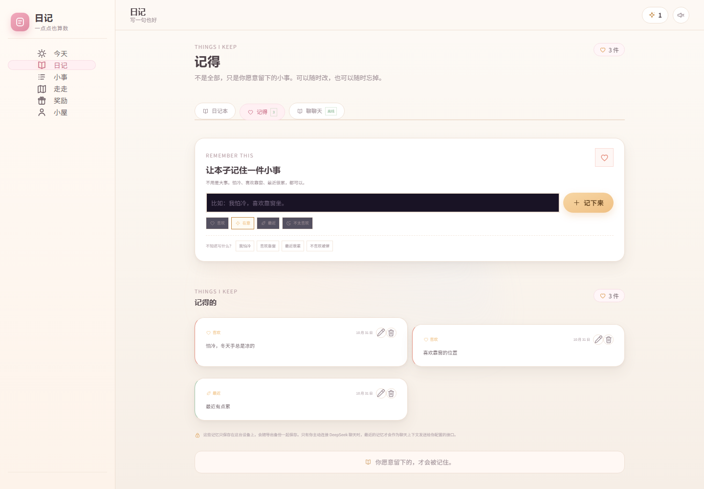
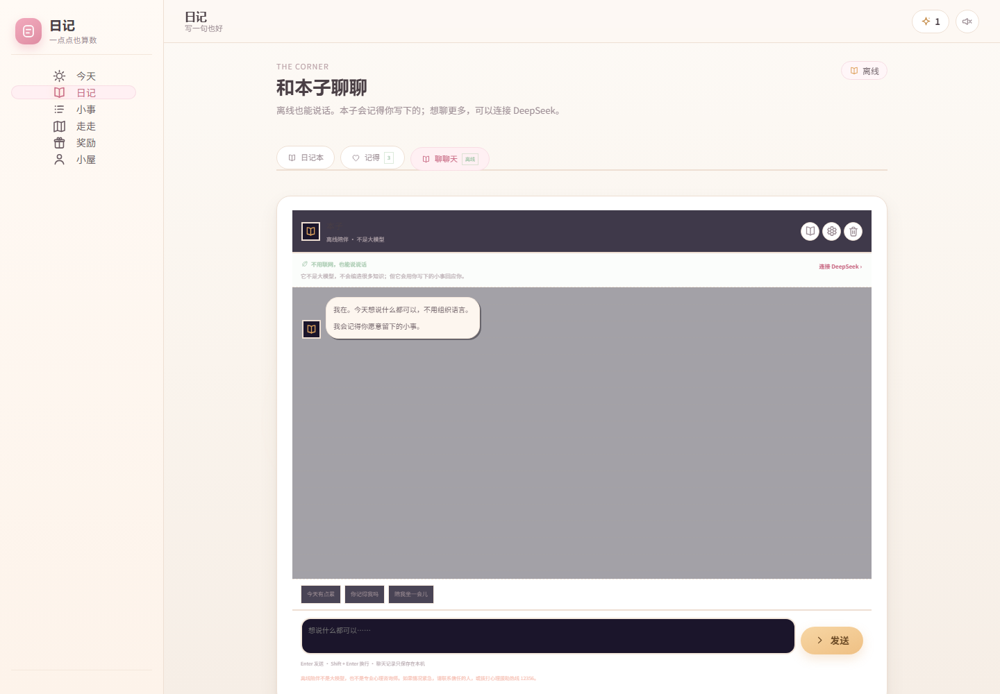
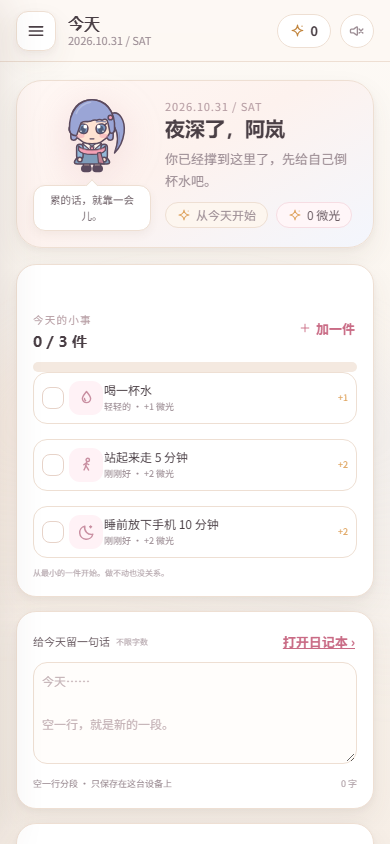

# 日记

> 一个不催你的日记本。写一句也好，做一件小事也好，都算数。

日记是一个偏「照顾自己」而不是「管理自己」的记录应用。没有排行榜，没有连续中断惩罚，也不要求每天都很有动力。写一句话、做一件小事、来喘口气，或者和本子说两句话，都算数。



<p align="center">
  
  
  
</p>

<p align="center">
  
</p>

- 网页版：<https://wangji330330-ops.github.io/113/>
- [GitHub Release](https://github.com/wangji330330-ops/113/releases)
- [更新日志](CHANGELOG.md)

## 现在有什么

- **今天**：一个 Q 版大头、今天的小事、给今天留一句话、今天感觉怎么样。主页只有这四块，其他都在各自的页面里。
- **24 个 Q 版大头**：全部是项目内原创的 SVG，可以随时换。点一下会 Q 弹一下，并说一句话。
- **13 个手绘场景**：家里 4 个（客厅 / 房间 / 厨房 / 卫生间），外面 9 个（学校 / 图书馆 / 电影院 / 郊游 / 超市 / 球场 / 江边 / 爬山 / 兜风）。
  - 大头会站在场景里，大小是场景高度的 1/8。
  - 点场景里的空地，它会走过去（左右移动 + 走路时的小跳）；点它自己会 Q 弹。
  - 点场景里的物件，会有对应的一句话和小动画。
- **日记本**：按日期归档。「给今天留一句话」不限字数，空一行自动分段；旧日记可以单独打开编辑。日记只保存在本机。
- **记得**：写下怕冷、喜欢靠窗、最近很累、不喜欢被催这些小事；可以分类、编辑、忘掉。只保存在本机，会随导出备份保存。
- **说说话**：默认是免费的离线陪伴，不联网、不调用模型、不花钱。它会参考你写下的记忆回应，会接住常见情绪；它不是大模型，不会假装知道很多知识。
- **可选联网**：想聊更多时，可以接入 DeepSeek V4.1 Flash。需要你自己的 API Key，直接在设备上请求官方接口，不经过第三方代理。
- **奖励**：名字、图标、难度、达成条件都由自己定。不是完成任务的工资，是愿意好好对待自己的证据。
- **小事**：今日打卡的三件小事可以自由增删改；点一下完成，再点一下取消。
- **成长与回顾**：等级、出现天数、完成次数、最长连续、月历足迹。
- **本地优先**：打卡、日记、记忆、形象和设置保存在浏览器 `localStorage`，不登录、不上传；支持导出 / 导入备份。
- **PWA / 离线**：可添加到主屏幕，Service Worker 缓存应用；除联网聊天外，其余功能可离线使用。
- **导航**：左侧竖条。电脑上常驻，手机上用左上角的三条横杆打开。

## 形象

- 入口：**小屋 → 人物形象**，或今天页点头像。
- 24 个形象全部是 `assets/js/avatar.js` 里用参数化 SVG 画的原创角色：发型 × 发色 × 眼睛 × 肤色 × 服装 × 配饰组合而成，不涉及任何已有动漫角色。
- 每个形象支持 4 种表情：`idle` / `happy` / `tired` / `sad`，会跟随「今天感觉怎么样」变化。
- 想自己加一个：在 `AVATARS` 里复制一行 `makeAvatar(...)` 改参数即可。

## 场景

- 入口：**走走**。13 个场景由 `assets/js/scene-art.js` 生成，全部是内联 SVG，没有位图资源。
- 每个场景的物件坐标写在 `assets/js/place-data.js` 里（归一化 0–1），热区和画面是对齐的。
- 想让大头换个站位：改 `place-data.js` 里对应场景的 `char.x`（0–384）。

## 记得 & 说说话

- 入口：**日记 → 记得 / 说说话**。
- 写下一件小事，选「喜欢 / 在意 / 最近 / 不太喜欢」，就收进本机的小本子。
- 离线聊天不联网、不花 API 的钱，会参考你写下的记忆；你可以点自己那句话下面的「记住」把它收进小本子。
- 遇到危机内容，离线陪伴会给出去找信任的人、120/110 和心理援助热线 12356 的求助信息，而不是普通安慰。

## 联网聊天怎么用

1. 在 [DeepSeek 开放平台](https://platform.deepseek.com/api_keys) 创建一个 API Key。
2. 打开「日记 → 说说话 → 连接 DeepSeek」，粘贴 Key，保存。
3. 保存后会自动切到联网模式。默认模型是 `deepseek-flash`。

说明：

- 请求从你的设备直接发往 `https://api.deepseek.com`，不经过日记自己的服务器。
- Key 以明文保存在当前设备的 `localStorage` 中，**不会进入导出备份**；聊天记录也只保存在本机。
- 聊天内容会发送给 DeepSeek，并按 DeepSeek 的 API 计费。
- 不要把密码、身份证号、住址等敏感信息发进聊天。

## 更新机制

- 网页版、PWA：设置里的「版本与更新」会读取 `version.json`。有新版时点「更新并刷新」，会先更新 Service Worker，再重新载入新资源；记录存在本地，不会丢。
- Android APK：检查到新版后会打开下载页。覆盖安装需要新旧 APK 使用同一个签名。
- 启动时会在联网状态下静默检查一次（每 12 小时最多一次），有新版会在侧栏「小屋」上显示一个小红点。

## 本地预览

```bash
npm start
```

打开 <http://127.0.0.1:4173/>。不需要安装依赖，`npm start` 启动的是一个零依赖的静态文件服务器。

## 部署网页版

仓库根目录本身就是可部署的静态站点，没有构建步骤。

- GitHub Pages：Settings → Pages → Deploy from a branch → `main` / `/ (root)`。
- 也可以直接上传到任意静态托管（Vercel、Netlify、Cloudflare Pages 等）。
- 所有路径都是相对的，因此放在 `/113/` 这样的子路径下也能正常工作。

## 项目结构

```text
index.html                  应用外壳（侧栏 + 内容区）
version.json                版本清单（检查更新用）
manifest.webmanifest        PWA 清单
sw.js                       离线缓存与更新
CHANGELOG.md                人类可读的更新日志
assets/
  css/style.css             基础样式（历史上是像素主题，仍保留部分结构）
  css/theme-v2.css          v0.5 主题层：浅色奶油配色、侧栏、场景、大头
  js/app.js                 应用启动、路由、侧栏开合、弹窗、交互
  js/views.js               六个页面的 HTML 模板
  js/avatar.js              24 个 Q 版大头的参数化 SVG 生成器
  js/scene-art.js           13 个场景的 SVG 绘制
  js/place-data.js          场景文案、热区坐标
  js/store.js               本地数据、统计、奖励、日记
  js/chat.js                DeepSeek 直连、历史与系统提示
  js/companion.js           免费离线陪伴与记忆回应
  js/updater.js             版本检查、Service Worker 更新、外部跳转
  js/icons.js               51 个柔和线条图标（24×24，currentColor）
  js/audio.js               WebAudio 音效合成
  js/data.js                预设内容、文案、等级、更新历史
  js/helpers.js             日期、转义、格式化小工具
  fonts/                    旧的像素字体（v0.5 起不再加载）
  icons/                    应用图标（v0.5 重新生成）
android/                    Android WebView 工程
scripts/                    本地服务器、图标生成、资源同步、构建模板
docs/                       README 预览图与形象/场景预览页
```

> `character.js` / `scene.js` / `places.js` 是 v0.4 的 Canvas 像素角色与场景，v0.5 起不再使用，保留是为了不打断旧缓存。

## 数据说明

- 存储键：`glimmer-nook:v1`（打卡、日记、记忆、形象、设置都在这里）
- 聊天设置：`glimmer-nook:deepseek`（只在本机；含 API Key）
- 聊天记录：`glimmer-nook:chat`（只在本机；最多保留最近 80 条）
- 每个自然日每件小事只记一次；取消打卡会同步修正统计。
- 「出现天数」= 完成过至少一件小事，或完成过一次呼吸练习的日期数；只写日记不算打卡，但会出现在日记本里。
- 「最长连续」按历史最长计算，断掉也不会抹掉已经解锁的奖励。
- 换设备前建议在「小屋 → 导出备份」保存 JSON。备份包含打卡、日记、记忆和形象，不包含 API Key 和聊天记录。

## 发布新版本

1. 更新 `assets/js/data.js` 里的 `APP_VERSION`、`APP_BUILD` 和 `CHANGELOG`。
2. 同步更新 `package.json`、`version.json`、`sw.js` 的 `CACHE`、`android/app/build.gradle.kts` 的 `versionCode` / `versionName`。
3. 重新构建 APK（或用网页版/PWA），替换 `download/` 里的文件和 SHA256。
4. 创建新的 tag / Release，推送后等 GitHub Pages 构建完成。

## 关于

- 界面字体使用系统字体，不再加载像素字体。
- 图标与形象都是项目内原创的内联 SVG，没有第三方图片资源。
- 这个项目只有一个人写，功能会慢慢加。如果你也想要一个不太催人的记录工具，直接拿去改就好。

> 如果你最近真的很累，别一个人扛。找一个信任的人说说，或联系专业的心理支持。你不需要先变得有用，才值得被帮助。
