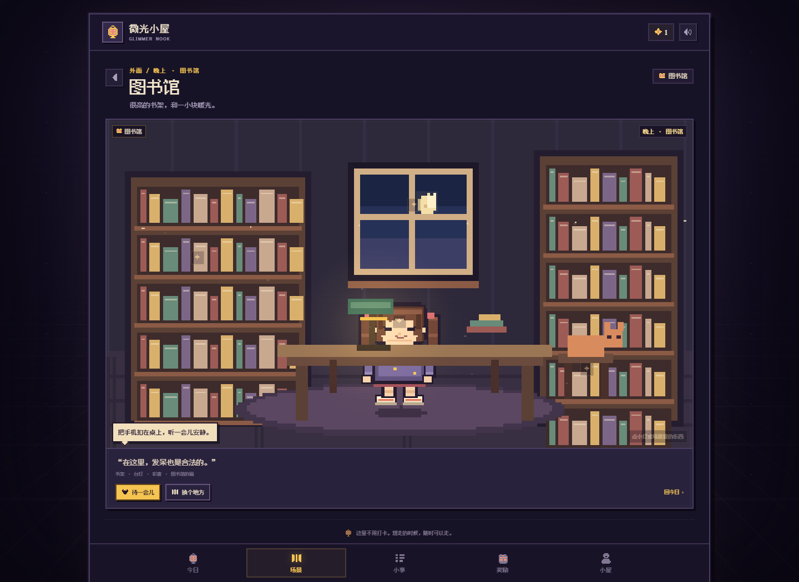

# 微光小屋 · Glimmer Nook

> 一个不催你的像素风打卡小屋。做到一点点，就点亮一点点。

微光小屋是一个偏「照顾自己」而不是「管理自己」的打卡应用。没有排行榜，没有连续中断惩罚，也不要求每天都很有动力。完成一件小事、来喘口气、去某个场景坐一会儿，都算数。




<p align="center">
  
</p>

- 网页版：<https://wangji330330-ops.github.io/113/>
- Android：[下载调试 APK v0.2.0](https://github.com/wangji330330-ops/113/releases/download/v0.2.0/glimmer-nook-v0.2.0-debug.apk)
- [GitHub Release v0.2.0](https://github.com/wangji330330-ops/113/releases/tag/v0.2.0)
- [更新日志](CHANGELOG.md)

## 现在有什么

- **今日打卡**：三件预置小事，可自由增删改；点一下完成任务，点错再点一下即可取消。
- **人物换装**：头、面、身、腿、鞋分开搭配，共有 8 / 8 / 8 / 8 / 6 种选择；在「小屋 → 人物形象」或点 Today 场景里的「换个样子」进入衣柜。
- **13 个可停留场景**：
  - 家里：客厅、房间、厨房、卫生间
  - 外面：学校、图书馆、电影院、郊游、超市、球场、江边、爬山、兜风
- **可交互场景**：每个场景都有 4 个可点击的小物件，会触发小灯的不同对话、粒子和动作；点小灯本人也会说话。场景本身也有台灯闪烁、水波、车窗外流动的夜景等待机动画。
- **能量签到**：快没电 / 还行 / 有点光。只影响小灯的表情和对话，不影响奖励。
- **喘口气**：半分钟呼吸引导。完成即算「今天来过」，会推进「出现天数」类奖励。
- **自定义小事**：名称、像素图标、难度（+1 / +2 / +3 微光）。
- **自定义奖励**：奖励内容自己写，达成条件支持累计出现天数、完成任务次数、积攒微光、最长连续天数。
- **成长与回顾**：微光等级、出现天数、完成次数、连续记录、月历足迹。
- **版本与更新**：设置内可检查更新、查看更新日志；网页版会通过 Service Worker 更新，Android 会跳转到新版 APK。
- **像素演出**：小灯呼吸/眨眼/被摸头/打卡跳跃，小猫呼吸，台灯闪烁，点灯与彩纸；页面切换有像素擦除动画。
- **音效**：WebAudio 实时合成的 8-bit 小声音，可关闭。
- **本地优先**：全部数据保存在浏览器 `localStorage`，不登录、不上传。支持导出 / 导入 JSON 备份。
- **PWA / 离线**：可添加到主屏幕，Service Worker 缓存应用与像素字体。

## 更新机制

- 网页版、PWA：设置里的「版本与更新」会读取 `version.json`。有新版时点「更新并刷新」，会先更新 Service Worker，再重新载入新资源；打卡数据存在本地，不会丢。
- Android APK：检查到新版后会打开 APK 下载页。下载后直接覆盖安装，WebView 的本地数据会保留。
- 启动时会在联网状态下静默检查一次（每 12 小时最多一次），有新版会在「小屋」标签上显示一个小红点。
- 版本清单在 [`version.json`](version.json)，完整历史在 [`CHANGELOG.md`](CHANGELOG.md)。

## 本地预览

```bash
npm start
```

打开 <http://127.0.0.1:4173/>。不需要安装依赖，`npm start` 启动的是一个零依赖的静态文件服务器。

## 部署网页版

仓库根目录本身就是可部署的静态站点，没有构建步骤。

- GitHub Pages：Settings → Pages → Deploy from a branch → `main` / `/ (root)`。
- 也可以直接上传到任意静态托管（Vercel、Netlify、Cloudflare Pages 等）。
- 所有路径都是相对的，因此放在 `/113/` 这样的子路径下也能正常工作。

## 下载 Android APK

- Release 下载：[glimmer-nook-v0.2.0-debug.apk](https://github.com/wangji330330-ops/113/releases/download/v0.2.0/glimmer-nook-v0.2.0-debug.apk)（约 2.2 MB）
- 仓库镜像：[download/glimmer-nook-v0.2.0-debug.apk](download/glimmer-nook-v0.2.0-debug.apk)
- 校验：[SHA256](download/glimmer-nook-v0.2.0-debug.apk.sha256)
- 支持 Android 7.0（API 24）及以上，版本 0.2.0（versionCode 2）。

安装步骤：

1. 在手机浏览器打开上面的 APK 链接下载。
2. 如果系统提示「不允许安装未知来源应用」，在浏览器/文件管理器的设置里允许本次安装。
3. 这是**调试签名**版本，适合自用测试，不建议上架应用商店。

## 打包 Android APK

### 自动构建（可选）

仓库提供了工作流模板：[scripts/android-build-workflow.yml](scripts/android-build-workflow.yml)。把它复制到 `.github/workflows/android.yml`，并确保推送凭据具有 `workflow` 权限后，GitHub Actions 会自动构建调试 APK。

### 本地构建

需要 JDK 17、Android SDK 35。用 Android Studio 打开 `android/` 目录，先同步网页资源：

```powershell
powershell -ExecutionPolicy Bypass -File scripts/sync-android.ps1
```

然后 Run / Build APK。也可以命令行：

```bash
cd android
gradle assembleDebug
```

APK 输出在 `android/app/build/outputs/apk/debug/app-debug.apk`。

如果 Windows 项目路径包含中文，请把 `android/` 复制到纯英文路径再构建（AGP 会检查路径）。

> 这是调试签名的 APK，适合自己安装使用，不适合直接上架应用商店。

## 项目结构

```text
index.html                  应用外壳
version.json                版本清单（检查更新用）
manifest.webmanifest        PWA 清单
sw.js                       离线缓存与更新
CHANGELOG.md                人类可读的更新日志
assets/
  css/style.css             全部界面与动画样式
  js/app.js                 应用启动、路由、弹窗、交互
  js/views.js               五个页面的 HTML 模板
  js/store.js               本地数据、统计、奖励解锁
  js/character.js           人物部件、搭配与绘制
  js/scene.js               Today 的像素客厅与小灯/小猫动画
  js/place-data.js          13 个场景的文案与可点击物件
  js/places.js              场景绘制、粒子与场景控制器
  js/updater.js             版本检查、Service Worker 更新、外部跳转
  js/icons.js               12×12 像素图标集
  js/audio.js               WebAudio 音效合成
  js/data.js                预设内容、文案、等级、更新历史
  js/helpers.js             日期、转义、格式化小工具
  fonts/fusion-pixel/       缝合像素字体（OFL-1.1）
  icons/                    应用图标
android/                    Android WebView 工程（含更新跳转桥）
scripts/                    本地服务器、图标生成、资源同步、构建模板
docs/                       README 预览图
download/                   APK 与校验文件
```

## 数据说明

- 存储键：`glimmer-nook:v1`
- 每个自然日每个习惯只记一次；取消打卡会同步修正统计。
- 「出现天数」= 完成过至少一件小事，或完成过一次呼吸练习的日期数。
- 「最长连续」按历史最长计算，断掉也不会抹掉已经解锁的奖励。
- 人物搭配保存在 `profile.look`，属于同一条本地数据，会一起导出/导入。
- 换设备前建议在「小屋 → 导出备份」保存 JSON。

## 一句题外话

如果你最近真的很累，别一个人扛。找一个信任的人说说，或联系专业的心理支持。你不需要先变得有用，才值得被帮助。

## 字体

[Fusion Pixel Font / 缝合像素字体](https://github.com/TakWolf/fusion-pixel-font)，SIL Open Font License 1.1。许可证见 `assets/fonts/fusion-pixel/LICENSE-OFL.txt`。
