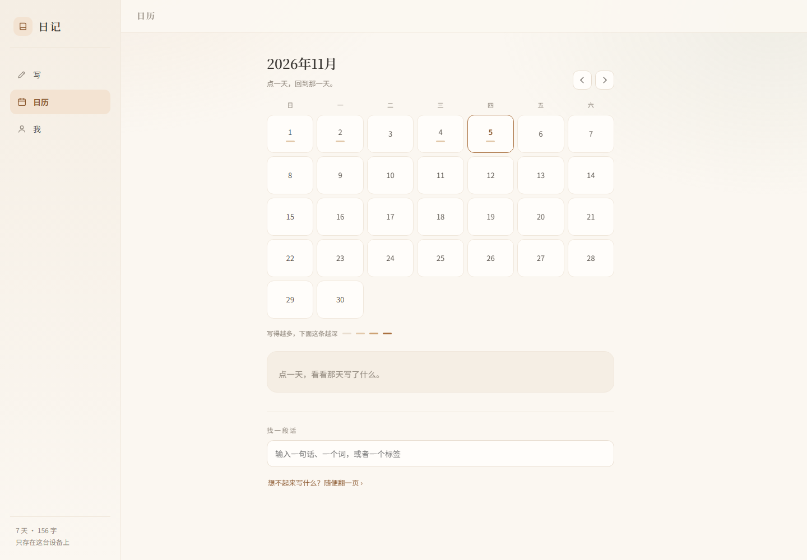
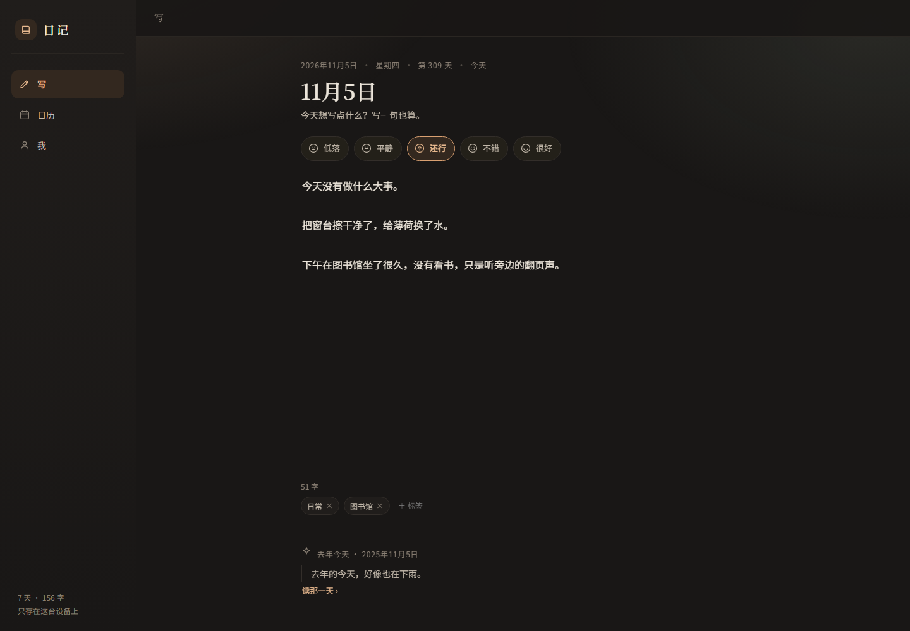

# 日记

> 一页一天。写了就算数，没写也不会被催。

一个很轻的日记本。打开就是今天那一页，写一句也算，写不出来有句子可以借。没有打卡、没有积分、没有排行榜，也不会因为你几天没写就变灰。


<p align="center">
  
  
</p>

<p align="center">
  
</p>

- 网页版：<https://wangji330330-ops.github.io/113/>
- Android：[下载调试 APK v1.0.2](https://wangji330330-ops.github.io/113/download/diary-v1.0.2-debug.apk)（约 1.4 MB，Android 7.0+）
- [更新日志](CHANGELOG.md)

## 现在有什么

- **一天一页**：打开就是今天。标题是日期，下面是空白的纸。写完自动保存，右下角会告诉你几点存的。
- **写不出来也可以**：空白页会递一句引导（"今天有哪个瞬间，你希望它慢一点？"），可以换一句，也可以直接关掉。
- **心情五档**：低落 / 平静 / 还行 / 不错 / 很好。点一下就好，再点一下取消，不写正文也能只标一个心情。
- **标签**：顺手加一两个词，以后能搜到。
- **日历回看**：月历上每天下面有一条小横线，写得越多颜色越深。点一天可以看那天写了什么，也可以补写。
- **去年今天**：写今天的时候，如果去年同一天有记录，会在下面露出来。
- **搜索**：在日历页搜一句话、一个词或者一个标签，直接跳到那一天。
- **随便翻一页**：想不起来写什么的时候，随机翻到过去某一天。
- **深色模式**：浅色 / 深色 / 跟随系统，三档字号。
- **本地优先**：所有内容只存在这台设备的 `localStorage`，不上传、不登录、没有服务器。
- **导出**：JSON 备份（能再导回来）和 Markdown（能放进别的笔记软件）。

## 为什么是这些

参考了 [Day One](https://dayoneapp.com/) 和 [Diarly](https://apps.apple.com/app/diarly-daily-journal-diary/id1387167765) 这类成熟日记应用的做法：**一天一页**是它们共同的核心，**提示词**解决"打开空白页不知道写什么"，**On This Day / 去年今天**负责让过去的内容重新被看见，**搜索**是内容变多后唯一的入口。这里没有抄功能表，只留了这几条最常用、最不打扰人的。

反过来，刻意没做的：

- 不做连续打卡惩罚、不做积分和等级 —— 那些会让人为了数字写，而不是为了自己写。
- 不做云同步和账号 —— 加了就要处理服务器、隐私和登录，这个项目只想做一个本子。
- 不做 AI 代写 —— 日记里的话应该是自己写的。

## 数据

- 存储键：`riji:v1`
- 一条记录的样子：

  ```json
  {
    "2026-11-05": {
      "text": "今天没有做什么大事。",
      "mood": "ok",
      "tags": ["日常"],
      "updatedAt": "2026-11-05T14:10:00.000Z"
    }
  }
  ```

- 正文为空、没有心情、没有标签的那一天会被自动删掉，不留空壳。
- 换设备前在「我 → 导出备份」存一份 JSON；导入时同一天取字数多的那份。
- 浏览器清缓存会把内容一起清掉，备份是唯一的保险。

## 本地预览

```bash
npm start
```

打开 <http://127.0.0.1:4173/>。不需要安装依赖，`npm start` 启动的是一个零依赖的静态文件服务器。

## 部署

仓库根目录本身就是可部署的静态站点，没有构建步骤。

- GitHub Pages：Settings → Pages → Deploy from a branch → `main` / `/ (root)`。
- 也可以直接传到任意静态托管（Vercel、Netlify、Cloudflare Pages）。
- 所有路径都是相对的，放在 `/113/` 这样的子路径下也能用。

## 项目结构

```text
index.html                  外壳：左侧导航 + 内容区
version.json                版本清单
manifest.webmanifest        PWA 清单
sw.js                       离线缓存
assets/
  css/app.css               全部样式（浅色 / 深色 / 响应式）
  js/main.js                路由、渲染、事件、自动保存、导入导出
  js/store.js               本地数据、日期、统计、搜索
  js/views.js               三个页面的模板
  js/prompts.js             引导句
  icons/                    应用图标
android/                    Android WebView 壳
download/                   APK 与校验文件
docs/                       README 预览图
scripts/                    本地服务器、图标生成
```

## 发布新版本

1. 改 `assets/js/main.js` 里的 `APP_VERSION`。
2. 同步 `package.json`、`version.json`、`sw.js` 的 `CACHE`、`android/app/build.gradle.kts` 的 `versionCode` / `versionName`。
3. 打包 APK，替换 `download/` 里的文件和 SHA256。
4. 提交、推送，等 GitHub Pages 构建。

> 如果你最近真的很累，别一个人扛。找一个信任的人说说，或联系专业的心理支持。
